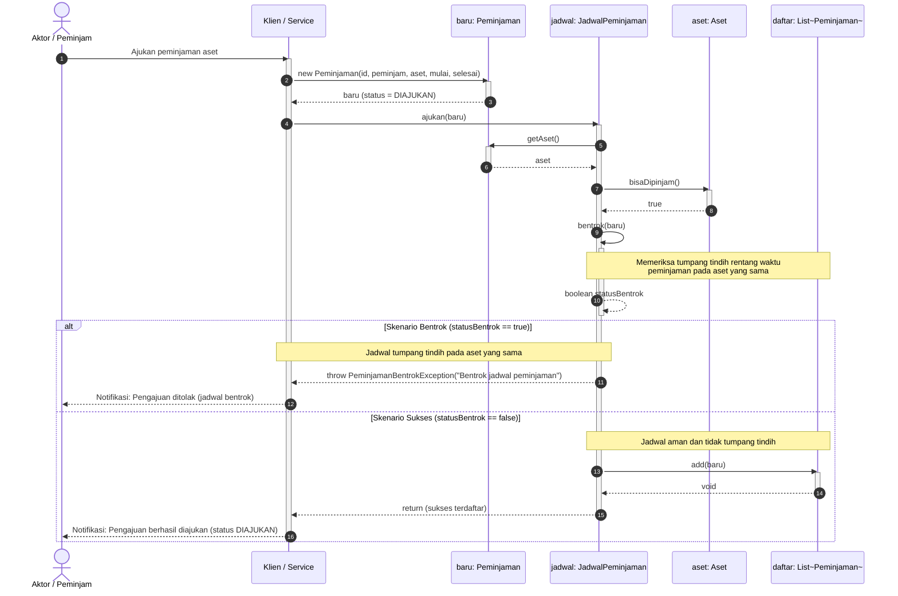

# Sequence Diagram: Pengajuan Peminjaman

Diagram sekuensial ini memodelkan proses pengajuan peminjaman (`ajukan(Peminjaman baru)`) pada kelas `JadwalPeminjaman`. Diagram mencakup skenario sukses dan skenario gagal/bentrok dengan memanfaatkan fragmen alternatif (`alt`).

## Deskripsi Skenario:

1. **Inisialisasi**: Pengguna menginisiasi permohonan peminjaman melalui sistem/klien. Dibuat instansi `baru: Peminjaman` dengan status awal `DIAJUKAN`.
2. **Validasi Kesiapan Aset**: Objek `JadwalPeminjaman` memeriksa apakah aset dapat dipinjam via `aset.bisaDipinjam()`.
3. **Pengecekan Bentrok Waktu**:
   - Jadwal memanggil metode internal `bentrok(baru)` untuk memeriksa daftar peminjaman aset yang sama pada rentang waktu `[mulai, selesai]`.
4. **Fragmen `alt`**:
   - **Cabang Bentrok**: Jika terdapat peminjaman aset yang sama dalam rentang waktu yang bertabrakan, sistem melempar exception `PeminjamanBentrokException`.
   - **Cabang Sukses**: Jika tidak ada jadwal yang berbenturan, objek peminjaman disimpan ke dalam koleksi internal `daftar` dan sistem mengonfirmasi keberhasilan pengajuan kepada peminjam.
